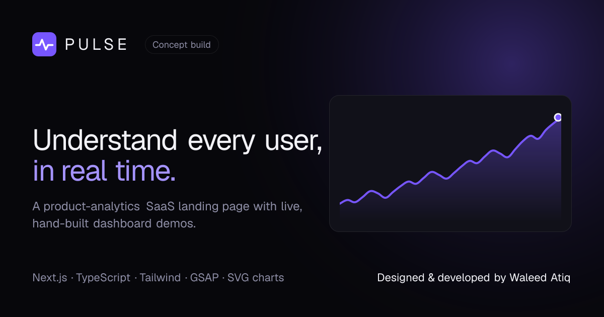
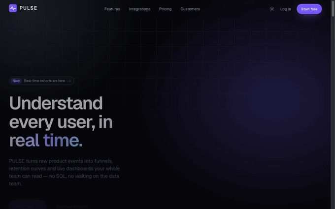
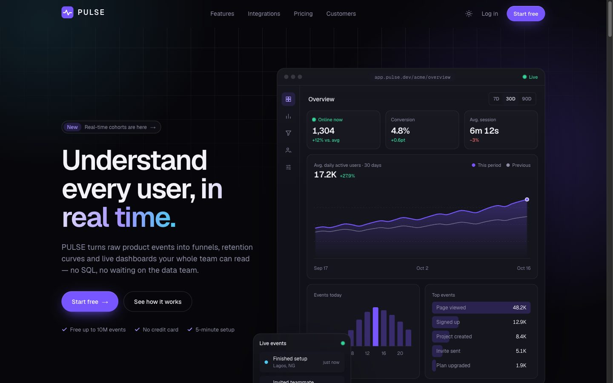
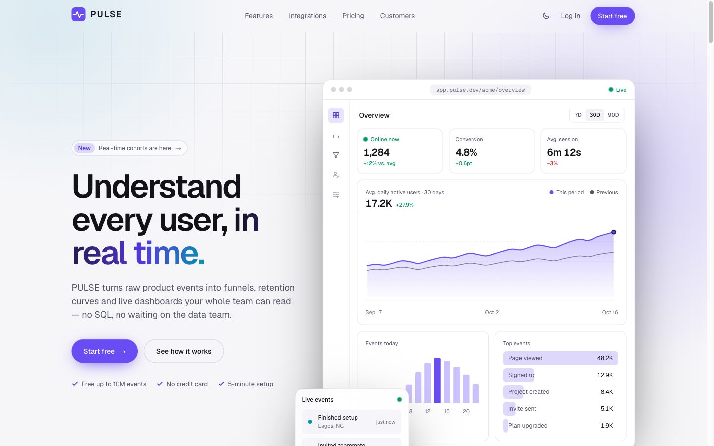
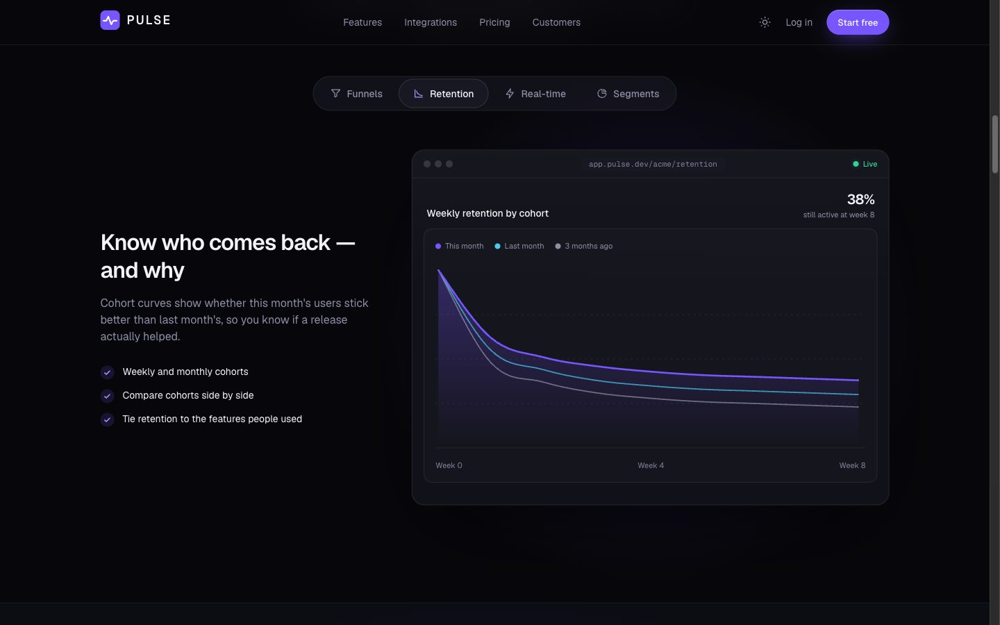
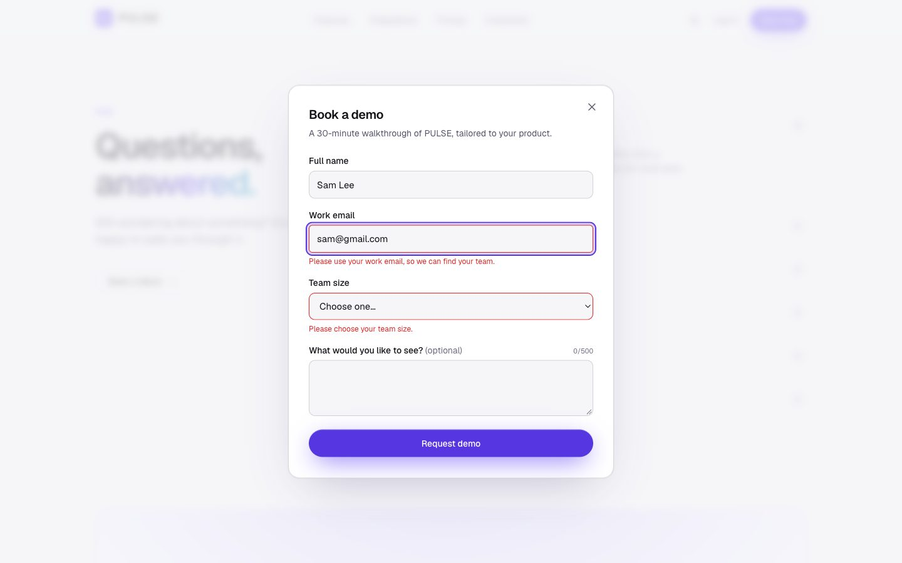
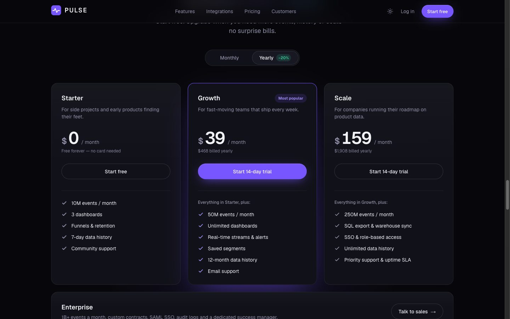
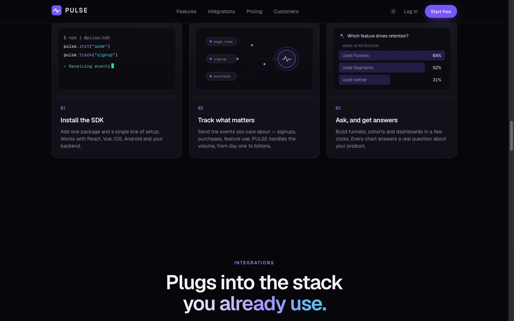
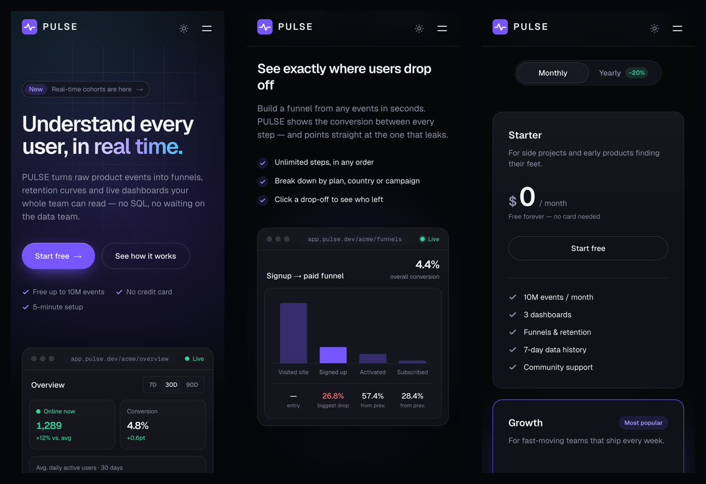

# PULSE — Product-analytics SaaS landing page



**Live site → [pulse-saas-landing.vercel.app](https://pulse-saas-landing.vercel.app)**

A high-end marketing site for a fictional product-analytics SaaS, in the style of Linear, Vercel and Stripe.
The point of the page: **the dashboards are real, not screenshots.** Every chart is hand-built SVG that draws
itself in, responds to hover, and redraws when you change a date range or switch a tab.

Designed & developed by **Waleed Atiq**. _Concept build — PULSE is not a real product; every number, logo,
name and quote is made up._



---

## Highlights

| | |
|---|---|
| **Live hero dashboard** | KPIs, a "users online" number that ticks, a live event feed, and a **7D / 30D / 90D switcher** that recalculates the numbers and redraws the chart. |
| **Interactive feature tabs** | Four dashboard previews (Funnels, Retention, Real-time, Segments). Built as a proper ARIA tab widget — arrow keys, Home/End, screen-reader announcements. |
| **Hand-built chart kit** | Line, bar, bar-list and donut charts in plain SVG — no chart library. Animated with CSS, so they cost almost nothing to run. |
| **Pricing that reacts** | Monthly/yearly toggle with tweening prices, an expandable plan-comparison table, and a native-HTML FAQ accordion. |
| **"Book a demo" form** | Native `<dialog>` modal with friendly validation: errors only after you leave a field, linked to their inputs for screen readers, focus jumps to the first problem. |
| **Light & dark themes** | One toggle re-themes the entire site, charts included, with no flash of the wrong theme on load. |
| **Scroll storytelling** | Count-up metrics, staggered reveals, a typing terminal, an integrations marquee — all switched off for visitors who ask their OS to reduce motion. |

## Screenshots

| Dark | Light |
|---|---|
|  |  |
|  |  |
|  |  |

**Mobile**



---

## Performance & quality

Measured with **Lighthouse 12.8** on the production build (`next build` + `next start`):

| | Performance | Accessibility | Best practices | SEO |
|---|:---:|:---:|:---:|:---:|
| **Desktop** | 100 | 100 | 100 | 100 |
| **Mobile** _(simulated mid-range phone on slow 4G)_ | 88 | 100 | 100 | 100 |

- **Page weight:** 240 KB of JavaScript (gzipped) — about 170 KB of that is the React/Next.js framework itself;
  9 sections of interactive charts and animation add ~70 KB. CSS is 10 KB.
- **Fully static:** the whole page is pre-rendered HTML served from Vercel's CDN.
- **Zero external requests:** fonts are self-hosted at build time; no analytics, trackers or third-party scripts.
- **Responsive:** checked at 10 widths from 320 px to 1920 px — no overflow, nothing clipped, tap targets ≥ 24 px.
- **Accessible:** WCAG AA contrast in both themes, full keyboard support, `prefers-reduced-motion` respected.
- **Shareable:** generated Open Graph image, sitemap, robots.txt, canonical URL and Apple touch icon.

---

## How it's built (the decisions worth talking about)

**Stack:** Next.js 16 (App Router) · TypeScript · Tailwind CSS v4 · GSAP ScrollTrigger · Lenis smooth scroll ·
React Compiler · deployed on Vercel.

- **Charts are hand-built SVG, not a library.** A chart library would add ~100 KB and look like every other
  dashboard. The draw-in trick is one line of CSS: a path with `pathLength="1"` animates `stroke-dashoffset`
  from 1 to 0. Re-animating on a tab change is free — the chart gets a new React `key` and remounts.
  → [`components/charts/`](components/charts)
- **Server Components by default, client only where needed.** Sections that just display content ship no
  JavaScript; only interactive pieces (charts, tabs, the form) are Client Components.
- **One set of design tokens.** Every color, radius, shadow and the 861 px breakpoint lives in
  [`app/globals.css`](app/globals.css). Components never contain hex codes — which is why the light theme is
  a single block of overrides.
- **No hydration surprises.** Mock data is deterministic: hand-written, or produced by a _seeded_ random
  generator, so the server and the browser always render identical charts.
  → [`lib/mockData.ts`](lib/mockData.ts)
- **No flash of the wrong theme.** A tiny inline script applies the saved theme before the first paint.
- **Native HTML where it's better.** `<dialog>` for the modal (focus trap, Esc, focus return built in),
  `<details name>` for an exclusive accordion with zero JavaScript, a real `<table>` for the comparison.
- **Content is data.** Copy for pricing, features, FAQ, testimonials and integrations lives in [`lib/`](lib) —
  changing wording never means touching a component.
- **Performance was measured, not guessed.** Lighthouse showed blurred background "glows" were the main cost
  on phones; replacing `filter: blur()` with radial gradients took mobile from 72 → 88 and Speed Index from
  7.1 s → 1.6 s with no visible difference.

## Project structure

```
app/                  layout (metadata, theme script), page, globals.css (design tokens),
                      opengraph-image, apple-icon, sitemap, robots
components/
  sections/           one file per page section (Hero, Features, Pricing, FAQ, CTA…)
  charts/             LineChart, BarChart, BarList, DonutChart + shared math
  dashboard/          the fake app UI: window frame, stat tiles, live number, event feed
  features/ pricing/ how-it-works/ demo/   pieces used by a single section
  Nav, Footer, ThemeToggle, ScrollEffects, SmoothScroll
lib/                  all content and mock data (pricing, features, faq, testimonials…)
```

## Run it locally

```bash
npm install
npm run dev
```

Then open the address it prints (usually http://localhost:3000; add `-- --port 3002` to choose another).

Other commands: `npm run build` (production build), `npm run lint`, `npx tsc --noEmit` (type-check).

> **Styles not updating while developing?** Turbopack's file watcher occasionally stops noticing CSS changes
> after a lot of activity in `node_modules`. Stop the dev server (Ctrl-C) and run `npm run dev` again.

## Deploy

Pushes to `main` deploy automatically on Vercel (the repo is connected to the Vercel project). No environment
variables are needed — there is no backend.

---

© 2026 · Concept build by **Waleed Atiq** · Not a real product.
